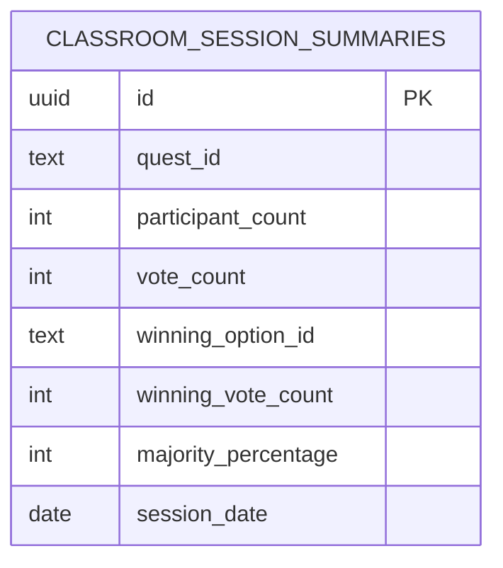

# 2. Data model and ER diagram

## Implemented entity

`classroom_session_summaries` stores one aggregate result per completed classroom session meeting the five-vote threshold.

| Attribute | PostgreSQL type | Key / rule | Meaning |
|---|---|---|---|
| `id` | uuid | Primary key; generated | Row identifier |
| `quest_id` | text | NOT NULL; CHECK allowlist | One of three supported classroom dilemmas |
| `participant_count` | integer | NOT NULL; CHECK 5–40 | Student participants |
| `vote_count` | integer | NOT NULL; CHECK 5–participant_count | Submitted votes |
| `winning_option_id` | text | NOT NULL | Winning option key for that quest |
| `winning_vote_count` | integer | NOT NULL; CHECK 1–vote_count | Votes for the winning option |
| `majority_percentage` | integer | NOT NULL; CHECK 1–100 | Rounded winning-vote percentage |
| `session_date` | date | NOT NULL; defaults to current date | Date used for recent-session reporting |

The quest catalog and option labels live in the application source (`src/features/classroom/data/classroomQuests.js`), not in relational tables. This implemented database therefore has no foreign keys and no persisted 1:1, 1:N, or M:N relationship. Active rooms, participant identities, and individual ballots are deliberately ephemeral and are not database entities.

## ER diagram of the persisted schema

No relationship line is shown because the current database has one table. Quest IDs are validated with a CHECK allowlist rather than a foreign key. If the quest catalog later becomes database-managed, a `classroom_quests` lookup table and a foreign key could replace that allowlist; that would be a schema change and requires a corresponding deployment migration.
