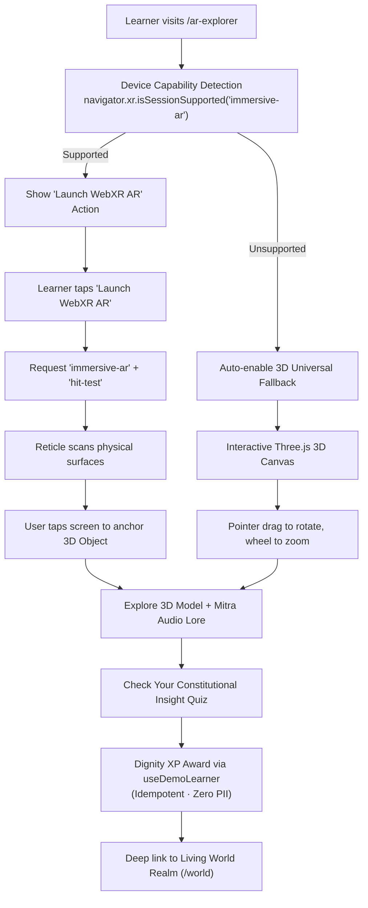

# RightsQuest AR Explorer — Classroom Wall-Mounted Augmented Reality Experience

> **Governing Standards:** Creative OS (`44_AGENCYLIKE_UI`, `01_DESIGN_OS`, `04_TYPOGRAPHY_SYSTEM`, `05_MOTION_SYSTEM`)  
> **Route:** `/ar-explorer`  
> **Technology Direction:** React 18 + Three.js (WebGL) + WebXR Device API (`immersive-ar`), with automatic Universal 3D Classroom Fallback.  
> **Target Audience:** Indian children aged 8–16, educators, guardians, and academic evaluators.

---

## 1. What is the RightsQuest Living Classroom?

The **RightsQuest Living Classroom** brings the Constitution of India alive through compact, museum-grade educational exhibits mounted directly on classroom walls. The experience is designed with an honest and clear distinction between two operating modes:

### Mode A: Live Camera WebXR AR (Wall Placement)
- Uses standard WebXR `immersive-ar` with camera passthrough displaying the student's real physical room.
- Detects vertical real-world surfaces (walls) via hit-test with pose normal alignment.
- Mounts a compact 35–45 cm constitutional exhibit flush against the real classroom wall.
- Includes on-screen controls to rotate left/right, scale/zoom, reset orientation, and reposition or remove the exhibit.
- Zero raw video or photo frames recorded, stored, or transmitted over the network (DPDP Act 2023 §9 compliant).

### Mode B: Virtual Classroom 3D Simulation (Wall Exhibit Fallback)
- Renders an authentic modern Indian classroom with a warm rear plaster wall.
- The constitutional learning artifact is mounted at eye level inside an architectural wall mounting frame with corner brackets, subtle contact shadow against the wall, and an engraved brass identification plaque.
- Secondary classroom context:
  - **Teacher’s Blackboard:** Positioned on the wall to the left of the exhibit, dynamically chalked with lesson topics, article references, and core constitutional principles.
  - **Student Study Desk:** Positioned naturally below and to the side as environmental context (not an oversized pedestal beneath the artifact), complete with open workbook, bookmark ribbon, pencil, and brass holder.
  - **Window:** Placed on the left wall with soft daylight streaming across the classroom.
  - **Mitra Companion:** Sits on an elegant wall display perch beside the exhibit, serving as an encouraging classroom docent companion.

### The 6 Classroom Wall Exhibits (~35–45 cm Compact Scale)
- **Lesson 1: The Sovereign Ashoka Chakra** (*Preamble & Article 51A*): Compact 43.6 cm circular exhibit with 24 Dharma spokes and cardinal medallions.
- **Lesson 2: The Balance of Equality** (*Articles 14–18*): Compact 42.5 cm wide classical balance scale with calibrated equilibrium gauge and weighted tokens.
- **Lesson 3: The Beacon of Expression** (*Article 19 & UNCRC 12*): Compact 35.4 cm tall Bal Sansad forum tower broadcasting concentric soundwaves.
- **Lesson 4: The Shield of Bodily Safety** (*Articles 21, 24 & POCSO*): Compact 37.7 cm tall protective shield deploying a translucent emerald sanctuary dome and 1098 beacon.
- **Lesson 5: The Scroll of Free Learning** (*Article 21A & RTE Act*): Compact 35.4 cm tall schoolhouse portal with swinging gates and unrolling Article 21A parchment.
- **Lesson 6: The Crest of Legal Remedies** (*Article 32 Dr. Ambedkar’s Pillar*): Compact 37.7 cm tall pillar with 5 crystal facets for constitutional writs firing light rays to the Apex Court crystal.

---

## 2. Why Augmented Reality (AR) over Virtual Reality (VR)?

| Dimension | Augmented Reality (AR) | Virtual Reality (VR) |
| :--- | :--- | :--- |
| **Hardware Accessibility** | Works on standard commodity Android smartphones via WebXR. | Requires expensive, specialized headsets (Meta Quest, Apple Vision Pro). |
| **Classroom Feasibility** | Students and teachers can use existing mobile devices on normal desks. | Bulky headsets isolate students and cause motion sickness in young children. |
| **Child Psychological Safety** | Children remain aware of their real-world surroundings and trusted adults. | Headsets disconnect children from their physical surroundings. |
| **Viva Demonstrability** | Instant one-tap demonstration in any standard browser or phone. | Requires carrying, charging, and configuring dedicated headset hardware. |
| **Architecture Reuse** | Directly leverages existing React 18, Vite, and Three.js pipelines. | Demands building a completely separate heavyweight standalone engine. |

---

## 3. System Architecture & Data Flow

---

## 4. Mode A (WebXR AR) vs. Mode B (3D Simulation Fallback) Comparison

| Feature | Mode A: Live Camera WebXR AR | Mode B: Classroom 3D Simulation Fallback |
| :--- | :--- | :--- |
| **Experience Goal** | Mount compact exhibits on the student's real physical room wall. | Believable 3D simulation of a modern Indian classroom with wall exhibit. |
| **Environment** | Real physical room via camera passthrough. | 3D virtual classroom: plaster rear wall, blackboard, window, study desk. |
| **Exhibit Mounting** | Anchored flush against real vertical wall via WebXR hit-test. | Mounted on classroom rear wall with slim frame, brackets & brass plaque. |
| **Object Scale** | Compact 35–45 cm real-world scale (1:1 display scale). | Compact 35–45 cm proportional exhibit on classroom wall. |
| **Inspection Controls** | On-screen buttons: rotate, zoom/scale, reset, reposition on wall. | Pointer drag, mouse wheel, on-screen rotate/zoom/reset buttons. |
| **Camera Access** | User-authorized WebXR camera pass-through (zero frames saved). | No camera required or requested. |
| **Supported Devices** | Android Chrome / WebXR-compatible mobile browsers. | 100% of modern browsers (Desktop, Laptop, Tablets, iOS, Android). |
| **Pedagogical Engine** | Full 3-tier age dilemmas, physical consequence animations & quiz. | Full 3-tier age dilemmas, physical consequence animations & quiz. |
| **Progression Sync** | Awards Dignity XP to local progress engine (idempotent). | Awards Dignity XP to local progress engine (idempotent). |

---

## 5. Child Privacy, Safety & DPDP Act 2023 Compliance

1. **Zero Video/Photo Capture:** The application uses browser-level WebXR session anchors. The JavaScript application never receives, records, or stores raw camera video frames.
2. **Zero Biometrics / Facial Recognition:** No face mesh, eye tracking, or identity analysis is conducted.
3. **No Cloud Upload:** All 3D rendering happens locally on the client GPU.
4. **Explicit User Initiation:** Camera access is never prompted on page load; it requires an explicit learner click on "Mount on Real Wall (AR)".
5. **Clean Session Exit:** When the user taps "Return to Virtual Classroom" or leaves the route, `session.end()` is invoked immediately, stopping all camera streams.

---

## 6. How to Demonstrate in a Viva or Evaluation

1. **Desktop Demonstration (Mode B — Classroom 3D Simulation):**
   - Navigate to `http://localhost:5173/ar-explorer`.
   - Show the examiner the **Classroom Wall Exhibit Stage**:
     - Point out the clear mode indicator: **Mode B: Classroom 3D Simulation (Wall Exhibit Fallback)**.
     - Note the compact 35–45 cm scale: the artifact is mounted on the rear wall inside an elegant brass display frame with identification plaque.
     - Point out the secondary classroom context: Teacher’s blackboard on the left, student desk with workbook and pencil below/to the side, and Mitra on the wall perch.
   - Use the on-screen inspection toolbar: **Rotate Left/Right**, **Zoom In/Out**, and **Reset View**.
   - Test dilemmas and observe physical spatial consequences (e.g. Balance of Equality tilting or balancing).
   - Answer the quiz question and show the live **Dignity XP** surge.
2. **Mobile AR Demonstration (Mode A — Live Camera WebXR AR):**
   - Open Chrome on a WebXR-compatible Android phone connected to the application.
   - Tap **Mount on Real Wall (AR)** $\to$ allow camera permission $\to$ point phone at a classroom wall.
   - The virtual classroom geometry hides; the real room is seen through camera passthrough.
   - Tap the wall: the compact 35–45 cm constitutional exhibit and brass identification plaque mount flush against the real wall!
   - Use on-screen controls to inspect or walk closer to read the plaque.

---

## 7. The 6 Spatial Constitutional Stations & Consequence Engine

| Station | Name & Articles | 3D Spatial Geometry | Dynamic Physical Consequence |
| :--- | :--- | :--- | :--- |
| **1** | **The Sovereign Ashoka Chakra** (Preamble & 51A) | 24 Dharma spokes, navy hub, golden rim | Full golden spoke aurora illumination and celestial rotation |
| **2** | **The Balance of Equality** (Articles 14–18) | Dual brass balance pans, fulcrum needle | Scales swing into horizontal equilibrium; central diamond glows |
| **3** | **The Beacon of Expression** (Article 19 & UNCRC 12) | Tiered transmission tower, student forum | Concentric animated translucent soundwave rings expand outward |
| **4** | **The Shield of Bodily Safety** (Articles 21, 24 & POCSO) | Armored shield, 1098 beacon, lotus seal | Translucent protective sanctuary dome expands over scene |
| **5** | **The Scroll of Free Learning** (Article 21A & RTE) | Schoolhouse portal, archway, parchment | Schoolhouse gates swing open; Article 21A parchment unrolls |
| **6** | **The Crest of Legal Remedies** (Article 32 Writs) | Dr. Ambedkar's pillar, 5 crystal prism facets | 5 radial crystal rays fire focused light beams to apex crown |

### 3-Tier Age Adaptation Engine
- **Ages 8–10 (Young Navigators):** Focuses on concrete, everyday playground and classroom scenarios (fair play, inclusion, safe boundaries, school attendance).
- **Ages 11–13 (Pathfinders):** Focuses on student councils (Bal Sansad), cyber safety, midday nutrition, non-discrimination, and child labor prevention.
- **Ages 14–16 (Youth Advocates):** Explores constitutional jurisprudence, fundamental duties vs. rights, Dr. Ambedkar's "Union of Trinity", public interest litigation, and habeas corpus / mandamus writs.

---

## 8. Reference Implementation: The Balance of Equality

The **Balance of Equality** (Station 2, Articles 14–18) serves as the benchmark reference model for RightsQuest spatial craftsmanship:
1. **Classical Architecture:** Built with a stepped brass pedestal base with chamfered ring moldings, a fluted column spindle, and a classical capital bracket.
2. **Mechanical Calibration:** Features an engraved front plaque, a calibrated circular gauge with left (-), right (+), and center gold zero markings, and a downward-pointing needle indicator.
3. **Tripod Suspension & Spun Bowls:** Each dish is a deep spun-brass bowl suspended by 3 tripod brass cords hanging from the arched crossbeam's end shackles.
4. **Tangible Opportunity Tokens:** Weighted golden tokens rest inside the pans, demonstrating physical equality vs. privilege.
5. **Damped Physics Animation:** The beam and needle oscillate with spring damping into perfect 0° equilibrium when an inclusive, constitutional decision is selected, counter-rotating both pans so the dishes stay level.

---

## 9. Mitra 3D Mascot Companion & Animation System

- **Anatomical Modeling:** Procedural fox geometry with saffron coat (`#DE7215`), cream belly/cheek fluff (`#FFFDF7`), black nose, triangular ears with inner cushions, almond eyes with catchlights, and natural eye-blinking cycles.
- **Floating Wisdom Lantern:** Floating golden core with dual spinning gyro-gimbal rings and an internal point light that dynamically shifts color and intensity:
  - **Celebrating (`#10B981` Emerald, 2.4 intensity):** When a constitutional choice or correct quiz answer is selected.
  - **Thinking (`#38BDF8` Sky Blue, 1.4 intensity):** During dilemma exploration.
  - **Concerned (`#F97316` Protective Amber, 1.6 intensity):** Gentle restorative guidance when an unfair choice is made.
  - **Explaining (`#F59E0B` Warm Gold, 1.8 intensity):** When inspecting specific spoke principles or Supreme Court writs.
- **Direct Part Interaction:** Tapping on Mitra triggers a cheerful greeting, while tapping the balance pans or stage models triggers immediate mechanical reactions.

