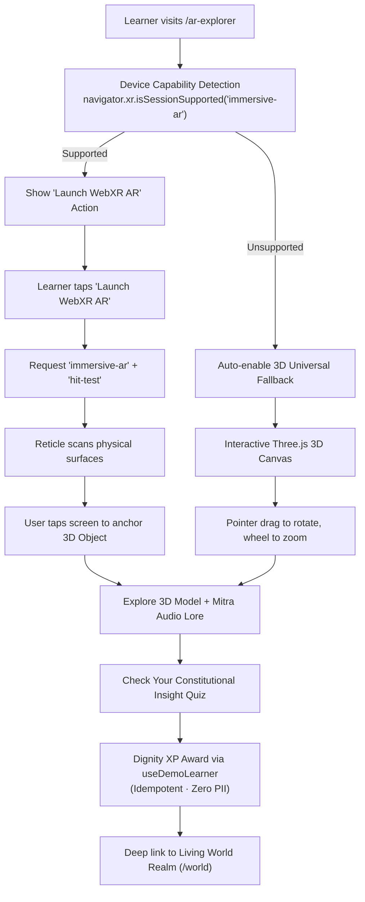

# RightsQuest AR Explorer — Living Classroom & Augmented Reality Experience

> **Governing Standards:** Creative OS (`44_AGENCYLIKE_UI`, `01_DESIGN_OS`, `04_TYPOGRAPHY_SYSTEM`, `05_MOTION_SYSTEM`)  
> **Route:** `/ar-explorer`  
> **Technology Direction:** React 18 + Three.js (WebGL) + WebXR Device API (`immersive-ar`), with automatic Universal 3D Classroom Fallback.  
> **Target Audience:** Indian children aged 8–16, educators, guardians, and academic evaluators.

---

## 1. What is the RightsQuest Living Classroom?

The **RightsQuest Living Classroom** brings the Constitution of India alive inside a modern, hands-on educational environment. The student experiences constitutional learning in two complementary ways:
1. **The Virtual 3D Classroom Studio (Universal Fallback):**
   - The student sits at a warm, polished teak study desk complete with an open workbook, bookmark ribbon, and wooden pencil.
   - Behind the desk on the rear wall hangs the **Teacher’s Blackboard**, dynamically written with chalk text introducing today's lesson, relevant constitutional articles, and core principles.
   - Sunlight streams in through an open classroom window, casting soft shadows across the desk.
   - In the center of the desk sits the interactive 3D constitutional artifact for today's lesson.
   - Beside the artifact sits **Mitra the Sun-Fox**, acting as an attentive, encouraging classroom study companion.
2. **Live WebXR Classroom AR:**
   - On compatible devices, students can anchor the constitutional artifacts directly onto their real classroom desk or room floor.
   - The virtual classroom geometry hides cleanly so the real physical room becomes the stage.
   - Real-world surface hit-testing with a golden placement reticle.
   - Zero video/photo frames recorded or uploaded; 100% on-device processing.

### The 6 Classroom Lessons
- **Lesson 1: The Sovereign Ashoka Chakra** (*Preamble & Article 51A*): Explore the 24 Dharma spokes and constitutional values on the study desk.
- **Lesson 2: The Balance of Equality** (*Articles 14–18*): Miniature tabletop demonstration scale testing fair equipment distribution and equal dignity.
- **Lesson 3: The Beacon of Expression** (*Article 19 & UNCRC 12*): Tabletop Bal Sansad student forum model broadcasting child voices through concentric soundwaves.
- **Lesson 4: The Shield of Bodily Safety** (*Articles 21, 24 & POCSO*): Protective learning object deploying a translucent emerald sanctuary dome and Childline 1098 beacon.
- **Lesson 5: The Scroll of Free Learning** (*Article 21A & RTE Act*): Schoolhouse gates that swing open 90° on the desk, unrolling the Article 21A parchment.
- **Lesson 6: The Crest of Legal Remedies** (*Article 32 Dr. Ambedkar’s Pillar*): Miniature constitutional model with 5 crystal facets for the 5 writs firing light rays to the Apex Court crystal.

---

## 2. Why Augmented Reality (AR) over Virtual Reality (VR)?

| Dimension | Augmented Reality (AR) | Virtual Reality (VR) |
| :--- | :--- | :--- |
| **Hardware Accessibility** | Works on standard commodity Android smartphones via WebXR. | Requires expensive, specialized headsets (Meta Quest, Apple Vision Pro). |
| **Classroom Feasibility** | Students and teachers can use existing mobile devices on normal desks. | Bulky headsets isolate students and cause motion sickness in young children. |
| **Child Psychological Safety** | Children remain aware of their real-world surroundings and trusted adults. | Headsets disconnect children from their physical surroundings. |
| **Viva Demonstrability** | Instant one-tap demonstration in any standard browser or phone. | Requires carrying, charging, and configuring dedicated headset hardware. |
| **Architecture Reuse** | Directly leverages existing React 18, Vite, and Three.js pipelines. | Demands building a completely separate heavyweight standalone engine. |

---

## 3. System Architecture & Data Flow

---

## 4. WebXR AR vs. 3D Fallback Comparison

| Feature | WebXR AR Mode (`immersive-ar`) | Universal 3D Fallback Mode |
| :--- | :--- | :--- |
| **Environment** | Real physical room (desk, table, floor) via camera pass-through. | Styled editorial canvas with subtle ambient studio lighting. |
| **Tracking** | WebXR surface plane detection (`hit-test`). | Mouse drag / touch drag inertial rotation. |
| **Camera Access** | User-authorized WebXR camera pass-through. | No camera needed or requested. |
| **Supported Devices** | Android Chrome / WebXR-compatible mobile browsers. | 100% of modern browsers (Desktop, Laptop, Tablets, iOS, Android). |
| **Learning Content** | Full constitutional descriptions, Mitra guidance & reflection quiz. | Full constitutional descriptions, Mitra guidance & reflection quiz. |
| **Progression Sync** | Awards Dignity XP to local progress engine. | Awards Dignity XP to local progress engine. |

---

## 5. Child Privacy, Safety & DPDP Act 2023 Compliance

1. **Zero Video/Photo Capture:** The application uses browser-level WebXR session anchors. The JavaScript application never receives, records, or stores raw camera video frames.
2. **Zero Biometrics / Facial Recognition:** No face mesh, eye tracking, or identity analysis is conducted.
3. **No Cloud Upload:** All 3D rendering happens locally on the client GPU.
4. **Explicit User Initiation:** Camera access is never prompted on page load; it requires an explicit learner click on "Launch WebXR AR".
5. **Clean Session Exit:** When the user taps "Exit AR" or leaves the route, `session.end()` is invoked immediately, stopping all camera streams.

---

## 6. How to Demonstrate in a Viva or Evaluation

1. **Desktop Demonstration:**
   - Navigate to `http://localhost:5173/ar-explorer`.
   - Show the examiner the **Interactive 3D Stage (Universal Fallback)**.
   - Click and drag the **Ashoka Chakra** to rotate the 24 golden spokes.
   - Switch to **Right to Education (Article 21A)** using the object selector tabs.
   - Point out Mitra's commentary and the real-world scenario example.
   - Answer the quiz question; show the live **Dignity XP** surge.
2. **Mobile AR Demonstration:**
   - Open Chrome on a WebXR-compatible Android phone connected to the Vite dev server or production URL.
   - Tap **Launch WebXR AR** $\to$ allow camera permission $\to$ point phone at the evaluation table.
   - Watch the golden placement ring anchor onto the desk.
   - Tap the screen: the 3D Ashoka Chakra and Mitra companion appear physically on the desk!

---

## 7. The 6 Spatial Constitutional Stations & Consequence Engine

| Station | Name & Articles | 3D Spatial Geometry | Dynamic Physical Consequence |
| :--- | :--- | :--- | :--- |
| **1** | **The Sovereign Ashoka Chakra** (Preamble & 51A) | 24 Dharma spokes, navy hub, golden rim | Full golden spoke aurora illumination and celestial rotation |
| **2** | **The Balance of Equality** (Articles 14–18) | Dual brass balance pans, fulcrum needle | Scales swing into horizontal equilibrium; central diamond glows |
| **3** | **The Beacon of Expression** (Article 19 & UNCRC 12) | Tiered transmission tower, student forum | Concentric animated translucent soundwave rings expand outward |
| **4** | **The Shield of Bodily Safety** (Articles 21, 24 & POCSO) | Armored shield, 1098 beacon, lotus seal | Translucent protective sanctuary dome expands over scene |
| **5** | **The Scroll of Free Learning** (Article 21A & RTE) | Schoolhouse portal, archway, parchment | Schoolhouse gates swing open; Article 21A parchment unrolls |
| **6** | **The Crest of Legal Remedies** (Article 32 Writs) | Dr. Ambedkar's pillar, 5 crystal prism facets | 5 radial crystal rays fire focused light beams to apex crown |

### 3-Tier Age Adaptation Engine
- **Ages 8–10 (Young Navigators):** Focuses on concrete, everyday playground and classroom scenarios (fair play, inclusion, safe boundaries, school attendance).
- **Ages 11–13 (Pathfinders):** Focuses on student councils (Bal Sansad), cyber safety, midday nutrition, non-discrimination, and child labor prevention.
- **Ages 14–16 (Youth Advocates):** Explores constitutional jurisprudence, fundamental duties vs. rights, Dr. Ambedkar's "Union of Trinity", public interest litigation, and habeas corpus / mandamus writs.

---

## 8. Reference Implementation: The Balance of Equality

The **Balance of Equality** (Station 2, Articles 14–18) serves as the benchmark reference model for RightsQuest spatial craftsmanship:
1. **Classical Architecture:** Built with a stepped brass pedestal base with chamfered ring moldings, a fluted column spindle, and a classical capital bracket.
2. **Mechanical Calibration:** Features an engraved front plaque, a calibrated circular gauge with left (-), right (+), and center gold zero markings, and a downward-pointing needle indicator.
3. **Tripod Suspension & Spun Bowls:** Each dish is a deep spun-brass bowl suspended by 3 tripod brass cords hanging from the arched crossbeam's end shackles.
4. **Tangible Opportunity Tokens:** Weighted golden tokens rest inside the pans, demonstrating physical equality vs. privilege.
5. **Damped Physics Animation:** The beam and needle oscillate with spring damping into perfect 0° equilibrium when an inclusive, constitutional decision is selected, counter-rotating both pans so the dishes stay level.

---

## 9. Mitra 3D Mascot Companion & Animation System

- **Anatomical Modeling:** Procedural fox geometry with saffron coat (`#DE7215`), cream belly/cheek fluff (`#FFFDF7`), black nose, triangular ears with inner cushions, almond eyes with catchlights, and natural eye-blinking cycles.
- **Floating Wisdom Lantern:** Floating golden core with dual spinning gyro-gimbal rings and an internal point light that dynamically shifts color and intensity:
  - **Celebrating (`#10B981` Emerald, 2.4 intensity):** When a constitutional choice or correct quiz answer is selected.
  - **Thinking (`#38BDF8` Sky Blue, 1.4 intensity):** During dilemma exploration.
  - **Concerned (`#F97316` Protective Amber, 1.6 intensity):** Gentle restorative guidance when an unfair choice is made.
  - **Explaining (`#F59E0B` Warm Gold, 1.8 intensity):** When inspecting specific spoke principles or Supreme Court writs.
- **Direct Part Interaction:** Tapping on Mitra triggers a cheerful greeting, while tapping the balance pans or stage models triggers immediate mechanical reactions.

