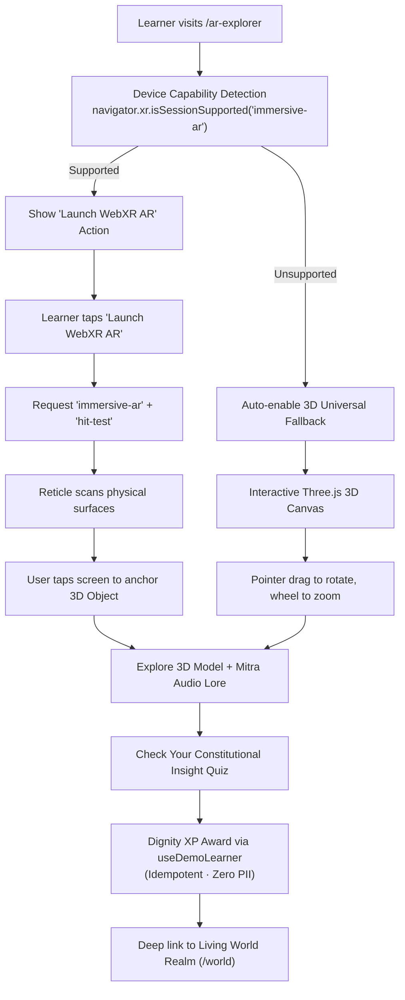

# RightsQuest AR Explorer — Augmented Reality Constitutional Learning

> **Governing Standards:** Creative OS (`44_AGENCYLIKE_UI`, `01_DESIGN_OS`, `04_TYPOGRAPHY_SYSTEM`, `05_MOTION_SYSTEM`)  
> **Route:** `/ar-explorer`  
> **Technology Direction:** React 18 + Three.js (WebGL) + WebXR Device API (`immersive-ar`), with automatic Universal 3D Fallback.  
> **Target Audience:** Indian children aged 8–16, educators, guardians, and academic evaluators.

---

## 1. What is the RightsQuest AR Explorer?

The **RightsQuest AR Explorer** brings the Constitution of India into the learner's physical environment. By pointing a compatible smartphone camera at a desk, floor, or classroom table, children can anchor interactive 3D constitutional artifacts into their real world:
- The **24-spoke Golden Ashoka Chakra of Justice & Dharma**.
- The **Balance of Equality** (Articles 14–18).
- The **Beacon of Freedom & Child Voice** (Article 19 & UNCRC Article 12).
- The **Shield of Bodily Safety & Shelter** (Articles 21, 24 & POCSO Act 2012).
- The **Scroll of Free & Compulsory Education** (Article 21A & RTE Act 2009).
- The **Crest of Constitutional Remedies** (Article 32 — Dr. B.R. Ambedkar’s Pillar).
- A 3D companion model of **Mitra the Sun-Fox**, guiding the learner through legal concepts.
- Miniature 3D gateways to the **Five Constitutional Realms**.

Where WebXR AR is unavailable (e.g. desktop computers, laptops, non-AR mobile browsers), the platform seamlessly provides an interactive **Three.js 3D Universal Stage** with orbit rotation, inspection zoom, and identical reflection quizzes.

---

## 2. Why Augmented Reality (AR) over Virtual Reality (VR)?

| Dimension | Augmented Reality (AR) | Virtual Reality (VR) |
| :--- | :--- | :--- |
| **Hardware Accessibility** | Works on standard commodity Android smartphones via WebXR. | Requires expensive, specialized headsets (Meta Quest, Apple Vision Pro). |
| **Classroom Feasibility** | Students and teachers can use existing mobile devices on normal desks. | Bulky headsets isolate students and cause motion sickness in young children. |
| **Child Psychological Safety** | Children remain aware of their real-world surroundings and trusted adults. | Headsets disconnect children from their physical surroundings. |
| **Viva Demonstrability** | Instant one-tap demonstration in any standard browser or phone. | Requires carrying, charging, and configuring dedicated headset hardware. |
| **Architecture Reuse** | Directly leverages existing React 18, Vite, and Three.js pipelines. | Demands building a completely separate heavyweight standalone engine. |

---

## 3. System Architecture & Data Flow

---

## 4. WebXR AR vs. 3D Fallback Comparison

| Feature | WebXR AR Mode (`immersive-ar`) | Universal 3D Fallback Mode |
| :--- | :--- | :--- |
| **Environment** | Real physical room (desk, table, floor) via camera pass-through. | Styled editorial canvas with subtle ambient studio lighting. |
| **Tracking** | WebXR surface plane detection (`hit-test`). | Mouse drag / touch drag inertial rotation. |
| **Camera Access** | User-authorized WebXR camera pass-through. | No camera needed or requested. |
| **Supported Devices** | Android Chrome / WebXR-compatible mobile browsers. | 100% of modern browsers (Desktop, Laptop, Tablets, iOS, Android). |
| **Learning Content** | Full constitutional descriptions, Mitra guidance & reflection quiz. | Full constitutional descriptions, Mitra guidance & reflection quiz. |
| **Progression Sync** | Awards Dignity XP to local progress engine. | Awards Dignity XP to local progress engine. |

---

## 5. Child Privacy, Safety & DPDP Act 2023 Compliance

1. **Zero Video/Photo Capture:** The application uses browser-level WebXR session anchors. The JavaScript application never receives, records, or stores raw camera video frames.
2. **Zero Biometrics / Facial Recognition:** No face mesh, eye tracking, or identity analysis is conducted.
3. **No Cloud Upload:** All 3D rendering happens locally on the client GPU.
4. **Explicit User Initiation:** Camera access is never prompted on page load; it requires an explicit learner click on "Launch WebXR AR".
5. **Clean Session Exit:** When the user taps "Exit AR" or leaves the route, `session.end()` is invoked immediately, stopping all camera streams.

---

## 6. How to Demonstrate in a Viva or Evaluation

1. **Desktop Demonstration:**
   - Navigate to `http://localhost:5173/ar-explorer`.
   - Show the examiner the **Interactive 3D Stage (Universal Fallback)**.
   - Click and drag the **Ashoka Chakra** to rotate the 24 golden spokes.
   - Switch to **Right to Education (Article 21A)** using the object selector tabs.
   - Point out Mitra's commentary and the real-world scenario example.
   - Answer the quiz question; show the live **Dignity XP** surge.
2. **Mobile AR Demonstration:**
   - Open Chrome on a WebXR-compatible Android phone connected to the Vite dev server or production URL.
   - Tap **Launch WebXR AR** $\to$ allow camera permission $\to$ point phone at the evaluation table.
   - Watch the golden placement ring anchor onto the desk.
   - Tap the screen: the 3D Ashoka Chakra and Mitra companion appear physically on the desk!

