# RightsQuest India — Living Story World & Documentation Gateway

Welcome to the architectural, creative, and engineering documentation for **RightsQuest India**, an agency-grade, story-driven gamified children's rights learning platform designed for children aged 8–16 across India.

---

## High-Level System Architecture

```mermaid
flowchart TD
    Intro["00. Kinetic Intro Preloader<br/>(Cormorant Garamond 'RightsQuest')"] --> Hero["01. Scene 01: The Invitation<br/>('Every child has a world of rights')"]
    Hero --> Parallax["02. Scene 02: The World Awakens<br/>(5 Connected Realms)"]
    Parallax --> Metaphor["03. Scene 03: Discover the Meaning<br/>(UNCRC 4 Pillars & Indian Statutes)"]
    Metaphor --> Companion["04. Scene 04: Meet Mitra<br/>(Sun-Fox Guardian & 9 States)"]
    Companion --> Gateway3D["★ 3D Sovereign Portal Tunnel<br/>(Golden 24-Spoke Ashoka Chakra • Warp Tunnel • White Light)"]
    Gateway3D --> MapPortal["05. Scene 05: The Adventure Begins<br/>(Interactive Vector Map Centerpiece)"]
    MapPortal --> FinalCTA["06. Scene 06: Final Invitation<br/>(Age Selection & 1098 Helpline)"]

    MapPortal --> WorldPage["Fullscreen World Map (/world)"]
    WorldPage --> Realms["5 Living Realms<br/>Belonging • Growth • Safety • Voices • Dignity"]
    Realms --> Landmarks["Interactive Landmarks<br/>(Banyan, First Bell, 1098 Beacon, Bal Sansad)"]
    Realms --> Modal["Realm Deep-Dive Modal<br/>(Lore, Principles, Mission Previews)"]
    Modal --> Adventures["Story Quests & Dilemmas (/adventures)"]
    Adventures --> Gameplay["Part 03: Branching Scenario Engine (/play/:scenarioId)"]
    Gameplay --> Choices["Ethical Decision Trees & In-Flow Controls"]
    Choices --> Consequence["Non-Punitive Consequence Feedback (Empathetic vs Learning)"]
    Consequence --> ArticleStamp["Constitutional Article Reveal Stamp (Art. 21A, POCSO, RTE)"]
    ArticleStamp --> Progression["Part 04: Living Progression System (/achievements)<br/>(XP Engine • 12 Badges • Streaks • Cooperative Goals)"]
    Progression --> Milestones["Gamified Milestone Celebrations<br/>(XP Surge • Web Audio Chimes • Shield Crests)"]
    Adventures --> Classroom["Part 05: Facilitator-led Classroom (/classroom)<br/>(Ephemeral Rooms • Private Voting • Bal Sansad Debate)"]
    Classroom --> ClassroomBackend["Node backend<br/>(WebSocket • Summary API • Mitra API)"]
    ClassroomBackend --> Supabase["Supabase<br/>(Aggregate session summaries only)"]
    ClassroomBackend --> Groq["Groq API<br/>(Mitra replies; chat not stored by RightsQuest)"]
    Progression --> Intelligence["Part 06: Educator & Guardian Intelligence System<br/>(NCERT/CBSE Mapping • Dinner Primers • Non-Surveillance)"]
    Intelligence --> Educator["Educator Studio (/educator)"]
    Intelligence --> Guardian["Guardian Chronicle (/guardian)"]
    
    FinalCTA --> SafetyHub["Part 07: Child Safety Library & Gateway (/safety)<br/>(3-Tier Age Adaptation • Verified Helplines • Sensitive Safeguards)"]
    SafetyHub --> GetHelp["Get Help Experience (/safety/get-help)"]
    
    subgraph Safeguards ["DPDP 2023 Child Privacy & Safety Layer"]
        Helpline["Childline 1098 Quickbar"]
        QuickExit["Quick Exit Safety Latch (Neutral Study Decoy)"]
        ZeroPII["No stored learner identifiers or individual votes"]
        DisclosureGuard["Non-Gamified Sensitive Disclosure Scanner"]
        MascotSafeguard["Mitra Concerned State (Safe Touch / Abuse)"]
    end
```



---

## Documentation Index

### 1. [Master Parts Roadmap (Parts 01–08)](./ROADMAP_PARTS_01_TO_08.md)
* **Part 01 (Complete):** Foundation, design tokens, kinetic preloader, application shell, and Lenis smooth scroll.
* **Part 02 (Complete):** The Living Story World (*The World of Every Child*), Mitra the Sun-Fox Mascot (9 expressive states & child safeguard behavior), vector interactive adventure map, and 6-scene cinematic landing storytelling.
* **Part 03 (Complete):** Branching scenario gameplay engine (`ScenarioRunner`), ethical decision trees (`ChoicePanel`), non-punitive consequence evaluation (`ConsequencePreview`), constitutional article reveal stamp (`ArticleRevealStamp`), evidence inspector (`EvidenceInspector`), three core demonstration missions + digital safety quest, age adaptation, persistent Childline 1098 modal, and 50-point QA suite.
* **Part 04 (Complete):** Deterministic idempotent XP engine (`rewardEngine`), 7 recognition tiers (`levels`), collectible treasure cabinet (`AchievementCollection`) with 12 tactile medallions, non-punitive 14-day consistency tracker (`StreakCalendar`), cooperative community quests (`CooperativeProgress`), and 67-point QA suite.
* **Part 05 (Complete):** Facilitator creates PIN rooms (`RQ-####`), students join with animal codenames, and private ballots reveal aggregate consensus before guided Socratic discussion. In-memory WebSocket relay on port 8787. 64-point QA suite.
* **Part 06 (Complete):** Educator Studio (`/educator`) with cohort-level aggregates, NCERT/CBSE curriculum alignments, Socratic toolkits, and anonymized deliberation logs. Guardian Chronicle (`/guardian`) with "At the Dinner Table" family primers and anti-addiction guarantees compliant with DPDP Act 2023 §9. 104-point QA suite.
* **3D Sovereign Portal Tunnel & Gamified Milestones (Complete):** Pinned Three.js dimensional warp bridge through the 24-spoke Golden Ashoka Chakra of Child Rights into Scene 05, plus high-vibe gamified milestone celebration modals. 25-point QA suite.
* **Part 07 (Complete):** Child safety and rights education library (`/safety`), 3-tier age adaptation (8–10, 11–13, 14–16), verified statutory directory (MWCD Childline 1098, 112, 1930, POCSO e-Box), Get Help experience (`/safety/get-help`), discreet Quick Exit safety latch with neutral study decoy screen, and sensitive disclosure safeguard scanner (zero XP gamification for trauma disclosures). 149-point QA suite.
* **Part 08 & Final Release (Complete):** Installable PWA with scalable, platform-sized icons; build-generated service worker precaching 53 app shell assets; IndexedDB saves and manages quest scripts locally (`list`, `remove`, `clear`); install/offline status controls; accessible 404 route handling; high-contrast `@media print` educator styles; and a 150 KiB gzipped initial-route budget (current build: 130.1 KiB). 9 automated test suites with **613 / 613 assertions passing (100% pass rate)**. Ready for supervised school pilot validation.

### 2. [Final Project Completion Report](./FINAL_PROJECT_COMPLETION_REPORT.md)
* Comprehensive pre-release report documenting project mandate, all 8 parts, 9 closure commits, test metrics, and statutory child safeguarding boundaries.

### 3. [Project Documentation Inventory](./PROJECT_DOCUMENTATION_INVENTORY.md)
* Complete catalogue and audit of all repository documentation, requirements, and dependencies.

### 4. [Final Remaining Roadmap](./FINAL_REMAINING_ROADMAP.md)
* Authoritative roadmap matrix classifying discovered workstreams and execution status.

### 5. [Supabase Database & Mitra AI Setup](./DATABASE_AND_MITRA_AI.md)
* Run the classroom summary schema in Supabase, configure server-only `.env` credentials, and start the frontend with the Node backend.
* Documents the anonymous summary threshold, Groq-backed Mitra API, external AI data handling, and current authentication boundary.

### 3. [Architecture & Codebase Deep Dive](./ARCHITECTURE_AND_CODE.md)
* Comprehensive technical walkthrough of every directory, component, data model, state hook, and safeguard.
* Complete breakdown of `src/features/world/`, `src/features/mascot/`, `src/features/storytelling/`, `src/features/gameplay/`, `src/features/progression/`, `src/features/classroom/`, `src/features/intelligence/`, `src/features/educator/`, `src/features/guardian/`, `src/features/gateway/`, `src/features/safety/`, and `src/pwa/`.
* Documents all 8 automated QA suites (595 total assertions), the PWA cache, Supabase aggregate-summary integration, and Groq-powered Mitra backend.

### 4. [Visual Design System & Creative Motion Architecture](./VISUAL_DESIGN_SYSTEM.md)
* Comprehensive agency-grade visual design specification following Creative OS principles (`44_AGENCYLIKE_UI`).
* Design tokens, typography scales, dynamic laser-beam card perimeters, photon sweeps, and tactile dossier skeuomorphism.

---

## Quick Reference Commands

```bash
# 1. Install project dependencies
npm install

# Copy .env.example to .env and fill in server credentials

# 2. Run local development server (Vite + React)
npm run dev

# Run the app and Part 05 classroom WebSocket relay together
npm run dev:classroom

# 3. Run all 595 automated QA, legal fidelity & child safety checks across 8 suites
npm test

# Run individual verification suites
npm run test:foundation   # 120 checks (Parts 01 & 02)
npm run test:part03       # 50 checks (Part 03 Scenario Engine)
npm run test:part04       # 67 checks (Part 04 Progression System)
npm run test:part05       # 64 checks (Part 05 Classroom System)
npm run test:part06       # 104 checks (Part 06 Intelligence System)
npm run test:transition   # 25 checks (3D Sovereign Portal Tunnel & Milestones)
npm run test:part07       # 149 checks (Part 07 Child Safety & Safeguards System)
npm run test:part08       # 16 checks (Part 08 PWA & Accessibility)
npm run test:release      # 18 checks (Final Release Verification Suite)
# Master test suite: 613 assertions across 9 dedicated test suites
npm test

# 4. Build optimized production bundle with dynamic chunk splitting
npm run build
```

---

## Statutory Grounding & Child Safeguarding Principles

RightsQuest India strictly translates real Indian jurisprudence into intuitive child-friendly storybook metaphors:

| Statute / Treaty | Indian & Global Legal Citation | Story World Manifestation |
| :--- | :--- | :--- |
| **Right to Free & Compulsory Education** | **Article 21A & RTE Act 2009** | *The Gardens of Growth* (Free schooling, midday meal cauldron, prohibition of corporal punishment). |
| **Child Labour Prohibition** | **Article 24 & Child Labour Act 2016** | *The Haven of Dignity* (Quenched glass kilns, prohibition of hazardous work under 18). |
| **Child Sexual Abuse Protection** | **POCSO Act 2012 & Safe Touch** | *The Forest of Safety* (Body boundaries, trusted adults, non-punitive confidential disclosures). |
| **Child Data Protection** | **DPDP Act 2023 Section 9** | Learner profiles use non-identifying local demo personas; classroom summaries omit individual identifiers; optional Mitra messages go to Groq only when enabled and are not stored by RightsQuest. |
| **Freedom of Expression & Participation** | **UNCRC Article 12 & Article 19(1)(a)** | *The River of Voices* (Bal Sansad children's parliaments, respectful democratic debate). |
| **Emergency Child Helpline** | **Childline 1098 (24/7 Toll-Free)** | Persistent Emergency QuickBar, 1098 Crystal Beacon, and Mitra protective companion guidance. |
