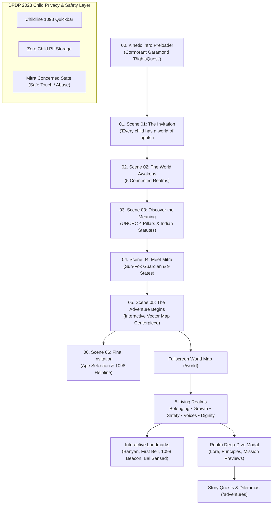

# RightsQuest India — Living Story World & Documentation Gateway

Welcome to the architectural, creative, and engineering documentation for **RightsQuest India**, an agency-grade, story-driven gamified children's rights learning platform designed for children aged 8–16 across India.

---

## High-Level System Architecture



---

## Documentation Index

### 1. [Master Parts Roadmap (Parts 01–08)](./ROADMAP_PARTS_01_TO_08.md)
* **Part 01 (Complete):** Foundation, design tokens, kinetic preloader, application shell, and Lenis smooth scroll.
* **Part 02 (Complete):** The Living Story World (*The World of Every Child*), Mitra the Sun-Fox Mascot (9 expressive states & child safeguard behavior), vector interactive adventure map, and 6-scene cinematic landing storytelling.
* **Parts 03–08 (Planned):** Branching scenario gameplay, dignity XP & progression, live classroom quiz rooms, teacher/parent dashboards, multilingual localization, and offline PWA.

### 2. [Architecture & Codebase Deep Dive](./ARCHITECTURE_AND_CODE.md)
* Comprehensive technical walkthrough of every directory, component, data model, state hook, and safeguard.
* Complete breakdown of `src/features/world/`, `src/features/mascot/`, and `src/features/storytelling/`.
* Explains how the interactive SVG vector terrain is engineered for 60fps performance without heavy 3D dependencies.
* Documents the 120-point automated QA test suite (`scripts/verify_foundation.mjs`).

### 3. [Visual Design System & Creative Motion Architecture](./VISUAL_DESIGN_SYSTEM.md)
* Comprehensive agency-grade visual design specification following Creative OS principles (`44_AGENCYLIKE_UI`).
* Design tokens: color palette (obsidian `#070A11`, parchment `#FBF8F3`, saffron `#DE7215`, peacock `#1B6D80`, terracotta `#D04F36`), typography scale (`Cormorant Garamond`, `Fraunces`, `Plus Jakarta Sans`, `Space Mono`).
* Dynamic laser beam cards, photon top-border sweeps, and tactile dossier skeuomorphism.
* Lenis inertia smooth scroll parameters and cubic-bezier easing tokens.

---

## Quick Reference Commands

```bash
# 1. Install project dependencies
npm install

# 2. Run local development server (Vite + React)
npm run dev

# 3. Run the 120-point automated QA, legal fidelity & child safety check
node scripts/verify_foundation.mjs

# 4. Build optimized production bundle with dynamic chunk splitting
npm run build
```

---

## Statutory Grounding & Child Safeguarding Principles

RightsQuest India strictly translates real Indian jurisprudence into intuitive child-friendly storybook metaphors:

| Statute / Treaty | Indian & Global Legal Citation | Story World Manifestation |
| :--- | :--- | :--- |
| **Right to Free & Compulsory Education** | **Article 21A & RTE Act 2009** | *The Gardens of Growth* (Free schooling, midday meal cauldron, prohibition of corporal punishment). |
| **Child Labour Prohibition** | **Article 24 & Child Labour Act 2016** | *The Haven of Dignity* (Quenched glass kilns, prohibition of hazardous work under 18). |
| **Child Sexual Abuse Protection** | **POCSO Act 2012 & Safe Touch** | *The Forest of Safety* (Body boundaries, trusted adults, non-punitive confidential disclosures). |
| **Child Data Protection** | **DPDP Act 2023 Section 9** | Zero child PII collected; non-identifying local demo avatars, zero tracking, zero advertising. |
| **Freedom of Expression & Participation** | **UNCRC Article 12 & Article 19(1)(a)** | *The River of Voices* (Bal Sansad children's parliaments, respectful democratic debate). |
| **Emergency Child Helpline** | **Childline 1098 (24/7 Toll-Free)** | Persistent Emergency QuickBar, 1098 Crystal Beacon, and Mitra protective companion guidance. |
